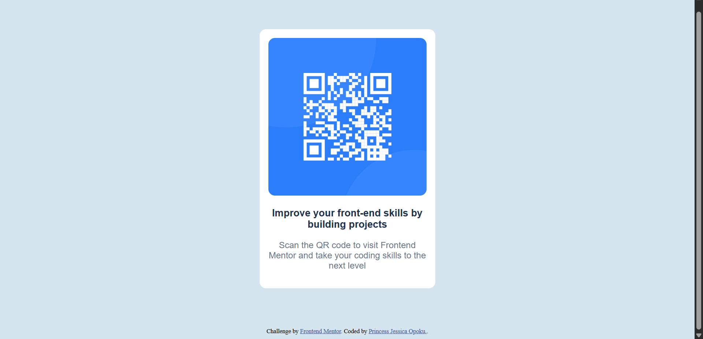

# Frontend Mentor - QR Code Component Solution

This is a solution to the [QR code component challenge on Frontend Mentor](https://frontendmentor.io). Frontend Mentor challenges help you improve your coding skills by building realistic projects. 

## Table of contents

- [Overview](#overview)
  - [The challenge](#the-challenge)
  - [Screenshot](#screenshot)
  - [Links](#links)
- [My process](#my-process)
  - [Built with](#built-with)
  - [What I learned](#what-i-learned)
- [Author](#author)

## Overview

### The challenge

The challenge was to build out this QR code component and get it looking as close to the design as possible using HTML and CSS.

### Screenshot

#### Desktop Preview


#### Mobile Preview


### Links

- Solution URL: [GitHub Repository](https://github.com/PJ-impact/QRC)
- Live Site URL: [Vercel Deployment](https://quickresponse-code.vercel.app/)

## My process

### Built with

- Semantic HTML5 markup
- CSS Custom Properties
- CSS Flexbox (for layout positioning and component alignment)
- Mobile-first workflow

### What I learned

During this project, I learned how to perfectly center a component in the middle of the viewport using modern CSS layouts rather than using absolute positioning hacks. 

1. **Centering with Flexbox:** Setting up a master parent wrapper to take up the full screen height and using flex alignment to snap items to the dead center:
   ```css
   .container {
     display: flex;
     flex-direction: column;
     justify-content: center;
     align-items: center;
     min-height: 100vh;
   }
   ```

2. **Managing Inner Spacing with Gap:** I learned how to use the `gap` shorthand property inside a column flex layout to keep elements uniformly spaced without overriding margin values on individual text elements:
   ```css
   .white-block {
     display: flex;
     flex-direction: column;
     gap: 16px;
     max-width: 320px;
   }
   ```

3. **Fluid Images:** Constraining an image's size relative to its parent container using `width: 100%` and `height: auto` to prevent visual overflow and keep layouts responsive.

## Author

- Frontend Mentor - [@PJ-impact](https://www.frontendmentor.io/profile/PJ-impact)
- GitHub Profile - [PJ-impact](https://github.com/PJ-impact)
